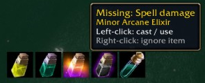
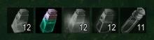
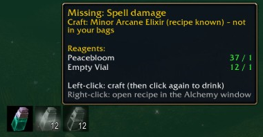
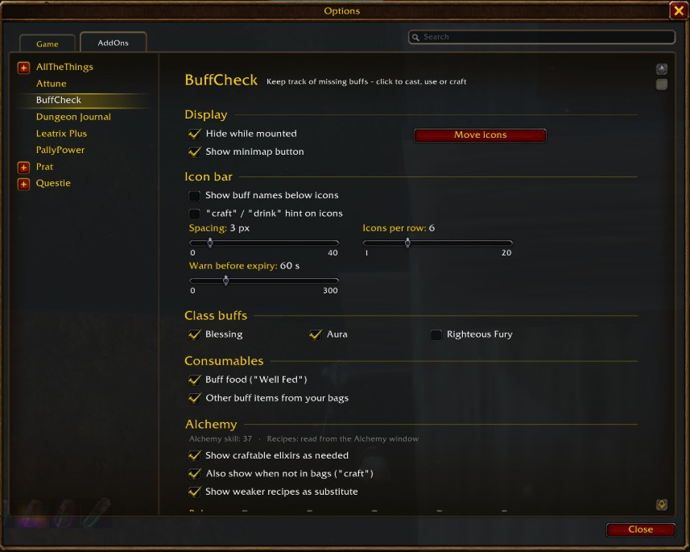

# BuffCheck

A World of Warcraft addon for **WoW Forever** (client interface `16001`) that shows which of your self-buffs are missing, out of combat. Click an icon to cast, use or craft what's missing.

It was built for a paladin alchemist, but the bag scan, food and elixir checks work for any class.

## Features

- **Class buffs (paladin):** blessing, aura and, optionally, Righteous Fury. Click to cast. When a blessing is about to expire, the click recasts that same blessing.
- **Buff food:** shows your buff food when "Well Fed" is missing.
- **Buff items from your bags:** elixirs, scrolls and other consumables whose buff lasts at least 10 minutes are detected automatically from their tooltip.
- **Alchemy:** elixirs and flasks you can craft count as "needed" for your role (all, auto by talent tree, healer, tank, damage).
  - Your known recipes and their reagents are read from the Alchemy window. Open it once per character.
  - A **grey icon** means "craft first". Left-click opens the Alchemy window at the right recipe, crafts one and closes the window again.
  - The number in the corner shows how many you can craft with the reagents you have. The icon turns **red at 0**.
  - Optionally a weaker recipe you have reagents for is offered instead (yellow border with a down arrow), and the tooltip lists what the better recipe is missing.
  - Right-click opens the recipe in the Alchemy window.
- **Expiring buffs:** a buff shows up before it runs out (configurable, default 60 s), with a countdown on the icon.
- **Cooldowns:** a cooldown spiral on each icon (global cooldown, item and spell cooldowns).
- **Layout:** spacing and icons per row are adjustable, buff names under the icons are optional, and the bar can be moved.
- **Localized:** German and English (other clients use English).

## Settings

Open the settings via **Options → AddOns → BuffCheck**, the minimap button (left-click) or `/bc`.

Minimap button:

- **Left-click:** open the settings
- **Right-click:** turn moving the icon bar on or off
- **Drag:** move the button around the minimap

Chat commands:

| Command | What it does |
| --- | --- |
| `/bc` | Open the settings |
| `/bc move` | Turn moving the icon bar on or off |
| `/bc minimap` | Show the minimap button again |
| `/bc food [link]` | Set your preferred buff food |
| `/bc item [link]` | Always watch this item |
| `/bc ignore [link]` | Ignore an item (right-clicking an icon does the same) |
| `/bc debug` | Print diagnostics to chat |

## Installation

Copy the `BuffCheck` folder to `World of Warcraft/_forever_/Interface/AddOns/` and reload the UI (`/reload`).

## Notes and limits

- The bar is hidden in combat. Addons can't change click-to-cast buttons during combat, and buff data is partly restricted there.
- WoW Forever doesn't let addon buttons cast recipes as spells. Crafting therefore goes through the Alchemy window, which the addon opens and closes for you.
- Drinking a crafted potion still needs your own click, because Blizzard only allows items to be used from a hardware click.
- Recipe data (skill levels, durations, effects) comes from Wowhead's WoW Forever database as of November 2026.

---

## Deutsch (Kurzfassung)

BuffCheck zeigt außerhalb des Kampfs, welche Selbst-Buffs dir fehlen: Segen, Aura, Buff-Essen, Elixiere und Schriftrollen aus der Tasche. Als Alchemist siehst du außerdem die Elixiere und Fläschchen, die du selbst herstellen kannst.

- **Graues Icon:** erst herstellen. Ein Klick stellt den Trank über das Alchemie-Fenster her.
- **Farbiges Icon:** benutzen.
- **Zahl in der Ecke:** wie oft deine Zutaten reichen. Bei 0 ist das Icon rot.

Einstellungen findest du unter **Optionen → AddOns → BuffCheck**, über den Minimap-Button oder mit `/bc`.

## License

[MIT](LICENSE)
